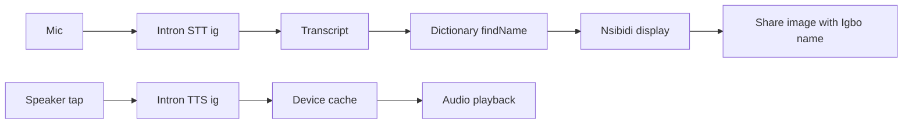

# Solution

**Category:** Education and Culture

## About Nketa

Nketa is the new name for **The Igbo Bible**, an Igbo language and heritage app. The rebrand reflects a broader mission: Nsibidi, proverbs, cosmology, calendar, and voice-first learning - not only Bible-related content.

Live product page: [theigbobible.netlify.app](https://theigbobible.netlify.app)

## Problem

Igbo is spoken by over 50 million people, but most speech tools struggle with Igbo names, mixed Igbo-English speech, and diacritics. Nsibidi, the indigenous Igbo writing system, is hard to reach if you cannot type Igbo correctly. Translation apps usually expect keyboard input and do not link speech to cultural symbols.

## Who it is for

- Igbo learners and diaspora reconnecting with language and heritage
- Parents who want Nsibidi representations of Igbo names
- Educators teaching proverbs, cosmology, and writing systems
- Users who prefer voice over typing, especially when diacritics are difficult

## App screen map

| Screen | Voice input | Voice output (TTS) | Code-switch relevance |
|--------|:-----------:|:------------------:|----------------------|
| Translate | Yes (streaming STT) | Yes (pronunciation) | Primary: mixed Igbo-English names and phrases |
| Browse / dictionary | Yes (search) | Yes | Spoken name lookup |
| Proverb practice | Yes (scored recitation) | Yes | Guided English intro + Igbo proverb |
| Cosmology | No | Yes | Igbo terms pronunciation |
| Calendar / market days | No | Partial | Cultural context |
| History timeline | No | No | Offline JSON content |
| Learn / content hub | No | Yes | Educational content |
| Saved words | No | Yes | Review saved translations |

## What we built

**Nketa** is a Flutter mobile app using Intron Voice AI:

1. **Speak a name, get Nsibidi** - Intron STT transcribes speech; substring dictionary match finds the Igbo name; Nsibidi symbol displayed and shareable.
2. **Proverb practice** - Recite a proverb (Igbo only or English intro + Igbo); code-switch-aware scoring with streak tracking.
3. **Igbo pronunciation** - Cosmology terms, proverbs, and names read aloud via Intron TTS with on-device caching.

## User journeys

### Journey 1: Diaspora parent, code-switched name

1. User opens **Translate**, taps mic.
2. Says: `"My name is Chinedu"`.
3. Intron STT returns the full phrase; `findName()` matches `Chinedu` via normalized substring search.
4. Nsibidi symbol for Chinedu appears; user taps **Generate Image**.
5. Shared image shows **Chinedu** (matched Igbo name), not the full English phrase. The translate screen still shows "Heard: My name is Chinedu" for transparency.

### Journey 2: Learner edits a bad transcript

1. User speaks an Igbo phrase; partial transcript streams on screen.
2. If STT mishears a diacritic, user edits the text field before lookup.
3. Typed search and dictionary fallback still work offline for known names.

### Journey 3: Proverb practice with code-switch

1. User opens **Proverb Voice Practice**, enables **Guided code-switch mode**.
2. Prompt shows: `"The proverb is..." then recite the Igbo proverb.`
3. User says: `"The proverb is Onye kwe chi ya ekwe"`.
4. `ProverbPracticeService` extracts the Igbo segment and scores it against the reference proverb.
5. Feedback shows score and matched Igbo segment; streak increments on pass.

## Code-switching in Nketa

Code-switching appears wherever users naturally mix Igbo and English:

| Pattern | Example | How Nketa handles it |
|---------|---------|---------------------|
| English frame + Igbo name | "My name is Chinedu" | Substring name lookup on full transcript |
| Igbo phrase + English | "Nna m bụ Emeka" | Same lookup; Intron `ig` mode |
| English intro + Igbo proverb | "The proverb is..." + proverb | Word-span extraction before scoring |
| Pure Igbo | "Chinedu" | Direct match |

**Why Intron Sahara:** Explicit Igbo language mode (`use_language_asr_input=ig`) targets African Igbo-English code-switch. Our [benchmark](benchmark-report.md) shows Intron leads on name lookup (14/50) vs Sunbird (8/50) and faster-whisper (0-3/50).

## Voice features

| Input | What happens next |
|-------|-------------------|
| Spoken Igbo name or phrase | Nsibidi lookup, save, share (Igbo name on image) |
| Spoken proverb | Code-switch-aware similarity score and feedback |
| Spoken search | Filter names in the dictionary |
| Tap speaker icon | Play Igbo pronunciation (cached locally) |

## Intron integration

| Component | Implementation |
|-----------|----------------|
| STT streaming | WebSocket `wss://infer.voice.intron.io/stt/v1/stream` |
| STT fallback | Sync file upload when WebSocket unavailable |
| TTS | REST API with on-device disk cache (`VoiceAudioCacheService`) |
| Language | `INTRON_ASR_LANGUAGE=ig`, `INTRON_VOICE_LANGUAGE=ig` |
| Config | `INTRON_API_KEY` in `.env` |

## Technical choices

| Choice | Why |
|--------|-----|
| Intron Sahara STT (`ig`) | Igbo-English code-switch support |
| Streaming STT WebSocket | Live partial transcript on Translate screen |
| Sync STT fallback | Works when WebSocket is unavailable |
| Substring name lookup | Tolerates English framing in spoken input |
| Proverb word-span scoring | Scores Igbo segment, not full mixed transcript |
| Local name dictionary first | Fast offline Nsibidi lookup |
| Intron Igbo TTS + disk cache | Fewer API calls on repeat playback |
| igbo_api Nsibidi source | Real symbols, not placeholder Unicode |

## Content

- 130 Igbo names with Nsibidi from igbo_api
- Proverbs, cosmology, stories, history timeline (JSON, GitHub-first with offline fallback)
